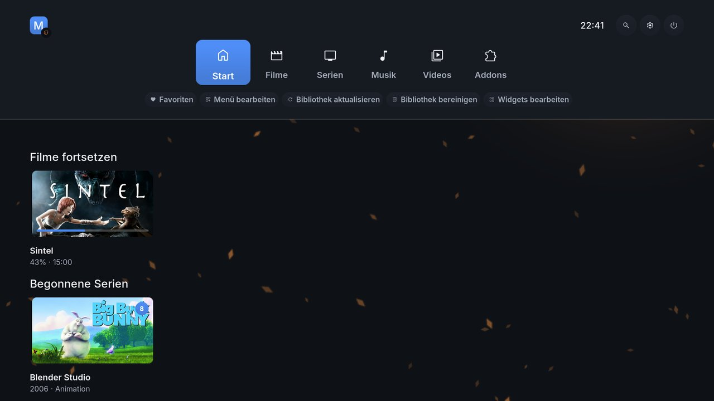
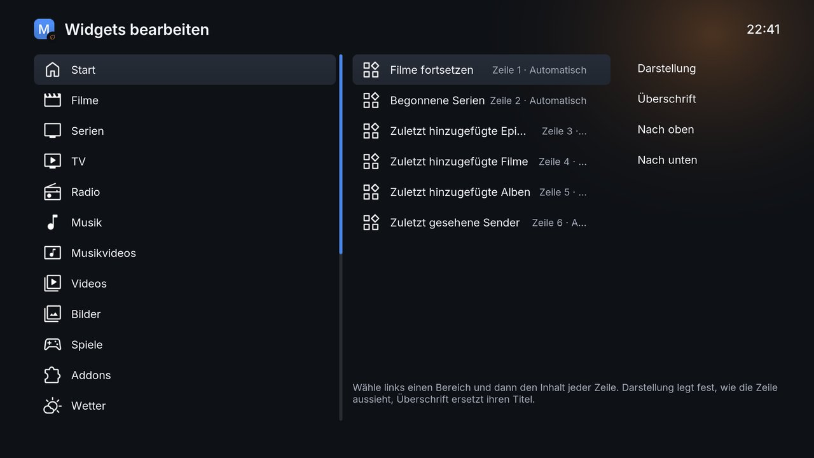
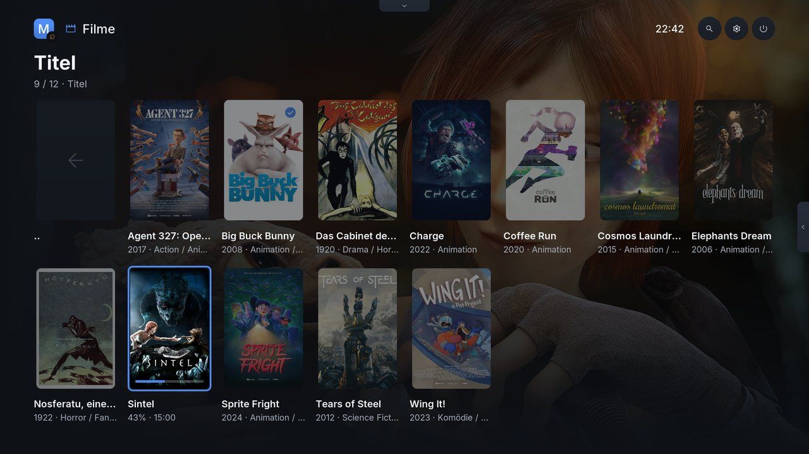
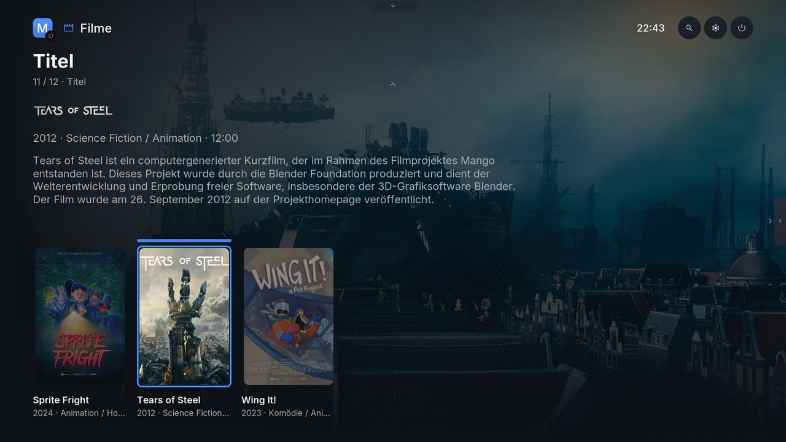
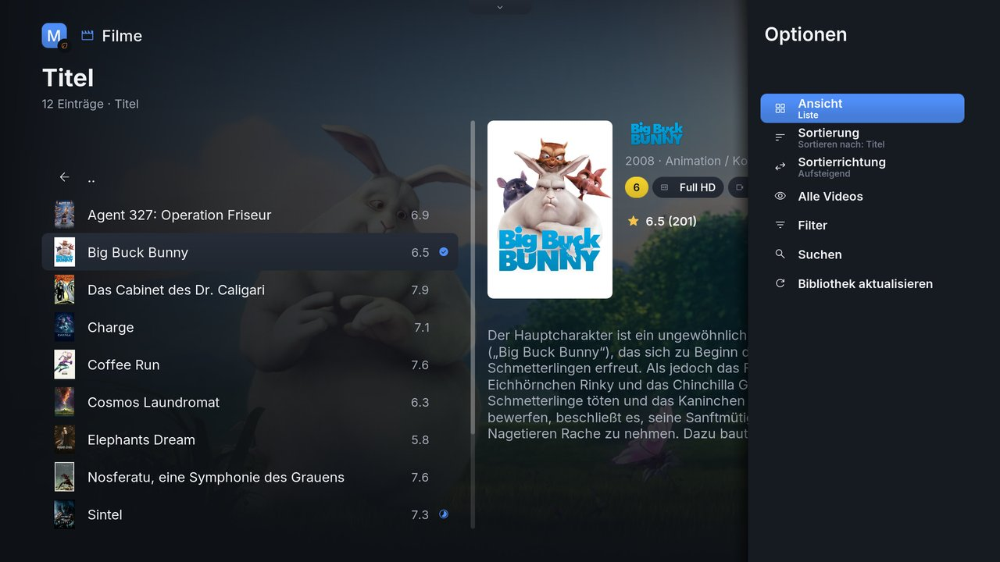
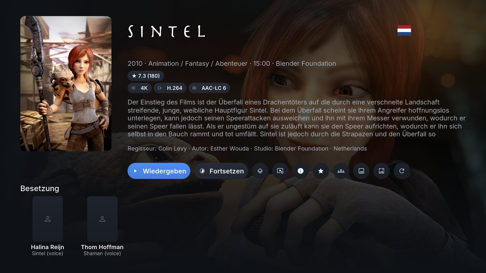
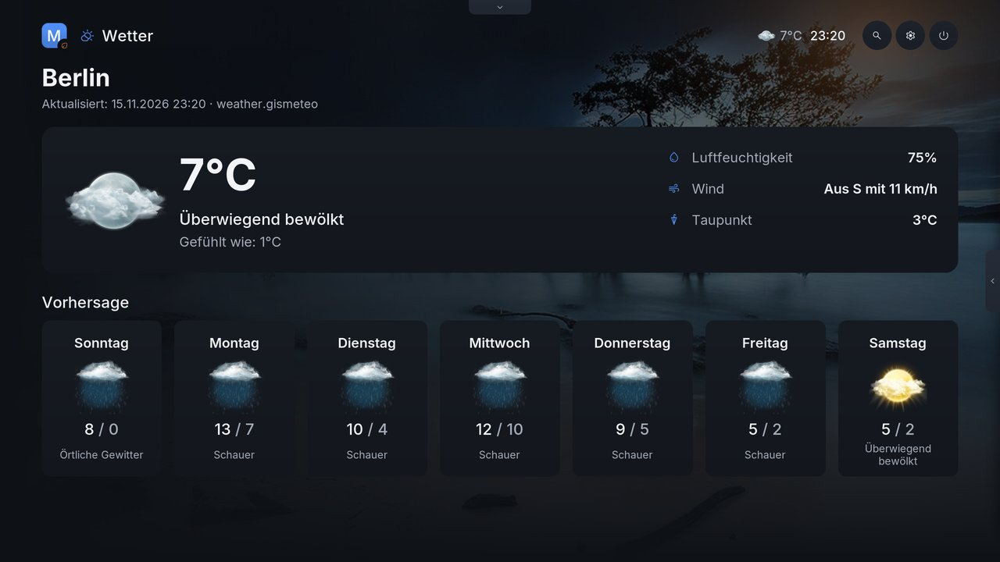

# Bedienung

## Hauptmenü

Das Hauptmenü ist verborgen, damit der Inhalt Platz hat. Es erscheint:

- **oben** (Standard): mit *hoch* aus der ersten Zeile, mit der Menütaste oder per Klick auf den Bereichsnamen
  oben links. Unter den Bereichen steht eine zweite Zeile mit den Unterpunkten des markierten Bereichs.
  Mit Maus oder Touch öffnet es auch die kleine Lasche am oberen Rand.
- **seitlich** (Einstellung „Hauptmenü seitlich“): mit *links* am Rand oder per Klick auf die Lasche am linken
  Rand. Rechts neben den Bereichen stehen deren Unterpunkte.

**OK** bzw. ein Tipp auf einen Bereich öffnet ihn. Bereiche ohne eigenes Fenster (Start, Zentrale) zeigen ihre
Zeilen auf der Startseite.

## Startseite

Oben steht der Titel des markierten Eintrags mit Kurzinfos, darunter bis zu sechs Inhaltszeilen des aktiven
Bereichs (z. B. „Begonnene Serien“, „Zuletzt hinzugefügte Filme“). Neben dem Titel einer Zeile steht beim Blättern
die Position („· 3/12“). Kleine Pfeile zeigen, in welche Richtungen es weitergeht (abschaltbar:
*Richtungshinweise*).

Ohne den Infobereich (Einstellung „Infobereich“) rücken die Zeilen nach oben.

Welche Zeilen ein Bereich zeigt, legst du im **Widget-Editor** fest (Unterpunkt „Widgets bearbeiten“ in jedem
Untermenü oder in den Skin-Einstellungen): links den Bereich, in der Mitte seine Zeilen, rechts die Knöpfe.

- **Inhalt** (OK auf eine Zeile): aus dem Katalog (zuletzt hinzugefügt, begonnen, zufällig, Addons, TV …) oder
  **„Eigene Quelle …“**: Kodi öffnet Bibliothek, Playlists, Addons oder Medienquellen; geh zum gewünschten Ordner –
  auch tief in einem Addon – und wähle im Optionen-Panel **„Als Startseiten-Zeile verwenden“**. Name und Darstellung
  übernimmt der Skin passend zum Inhalt. Wer den Pfad kennt, kann ihn auch eintippen.
- **Darstellung**: Querformat, Quadrat, Kacheln oder Wetter.
- **Überschrift**: eigener Titel für die Zeile (leer = Standardname).
- **Nach oben / Nach unten**: Zeilen umsortieren.

Neben Bibliothek und Addons gibt es Wetter-Zeilen: **Vorhersage** (jetzt und sieben Tage), **stündlich** und
**Details**. OK öffnet das Wetter. Sie sind im Bereich Wetter voreingestellt und lassen sich jedem Bereich hinzufügen
(braucht ein Wetter-Addon).

## Medienansichten

Filme, Serien, Musik usw. öffnen in der zuletzt gewählten Ansicht (Liste, Poster, Querformat, Quadrat, Detail,
Schaukasten, Fanart, Kacheln, Breit). Die Ansicht wechselst du im **Optionen-Panel**. Dort stehen auch Sortieren,
Filtern, Suchen und Bibliothek aktualisieren. So erreichst du es:

| Bedienung | Weg zum Optionen-Panel |
|---|---|
| Fernbedienung / Tastatur | in Listen *rechts*; in Rastern (Poster, Querformat, Kacheln) *rechts* in der letzten Spalte; im Schaukasten *runter* |
| Maus | Knopf mit den Reglern oben rechts oder die Lasche am rechten Bildschirmrand |
| Touch | Knopf oben rechts oder die Lasche am rechten Rand antippen |

**Position und Springen:** Oben unter dem Titel steht, wo du gerade bist (z. B. „12 / 26“). Mit den Zifferntasten der
Fernbedienung springst du zum Anfangsbuchstaben (wie bei SMS: 7 einmal = P, zweimal = Q …); beim schnellen Blättern
zeigt ein großer Buchstabe in der Mitte, wo du bist. Mit Maus oder Touch: Optionen-Panel → „Springen zu Buchstabe“.

Zurück oder *links* schließt das Panel wieder. Der Richtungspfeil am rechten Rand (Einstellung „Richtungshinweise“)
zeigt an, wann *rechts* das Panel öffnet.

**Info** (Taste *i* bzw. Info) auf einem Eintrag öffnet die Detailseite mit Handlung, Besetzung und Knöpfen zum
Abspielen, Trailer, Bewerten und mehr:

## TV und Radio

Der Programmführer zeigt die Sendungen als Zeitleiste; die Farbe am Rand steht für das Genre (Nachrichten, Sport,
Kinder, Film …). Senderlisten gibt es als Liste, Kacheln oder **„Jetzt und danach“** (laufende Sendung mit
Fortschritt, daneben die folgende). Die Ansicht wechselst du im Optionen-Panel.

Welche Seite sich öffnet, wenn du im Menü TV oder Radio wählst, legt die Einstellung **„TV und Radio öffnen mit“** fest.

## Wetter

Mit einem Wetter-Addon zeigt der Bereich Wetter die aktuellen Werte und die Vorhersage; die Vorhersage gibt es auch
als Startseiten-Zeile.

## Wiedergabe

- **Info** zeigt Titel, Fortschritt und technische Angaben (Auflösung, Ton, Sprache als Fahne).
- **OSD** (OK während der Wiedergabe): links Spuren/Untertitel/Einstellungen, Mitte Steuerung, rechts Extras.
- Läuft etwas im Hintergrund, zeigt der **Mini-Player** oben in der Mitte Titel, Zeit und Fortschritt;
  OK bzw. Klick öffnet das Vollbild.
- In den letzten Sekunden kündigt eine Karte an, was als Nächstes kommt.
- **Musik-Vollbild**: Cover mit drehender CD oder Schallplatte, Biografie und Liedtext (mit Addons). Bei **Radio**
  steht das Senderlogo auf einer hellen Kachel. Die Taste **Info** blendet alle Einblendungen aus und wieder ein –
  ohne Visualisierung sind sie anfangs sichtbar, mit Visualisierung anfangs ausgeblendet.

## Saisonale Akzente und Effekte

Zu Jahreszeit und Feiertagen zeigt der Skin ein Symbol am Logo, ein dezentes Leuchten und auf der Startseite fallende
Teilchen. Feiertag, Jahreszeit und Motiv haben je einen eigenen Schalter und können zusammen laufen – Einzelheiten
unter [Motive und Aussehen](Motive.md#saisonale-akzente-und-hintergrundeffekte).

## TV-Sicherheitsrand

Schneidet dein Fernseher den Bildrand ab, schalte **Design → TV-Sicherheitsrand** ein. Der Skin rückt dann alle
Texte und Bedienelemente 5 % vom Rand weg und lädt neu.

## Touch und Maus

Alles ist auch mit Maus und Touch bedienbar. Ein Tipp öffnet, Wischen blättert. Mit der Maus erscheinen die
Untermenüs schon beim Darüberfahren; das Hauptmenü bleibt offen, solange die Maus darüber ist.

Was Metis über einen üblichen Skin hinaus kann, zeigt die Seite [Was Metis anders macht](Besonderheiten.md).

---

[← Zur Übersicht](README.md)
