# Was Metis anders macht

Diese Seite zeigt die Funktionen, die über einen üblichen Kodi-Skin wie Estuary hinausgehen. Was jeder Skin kann
(Bibliothek durchsuchen, Filme abspielen, Einstellungen …), steht in der [Bedienung](Bedienung.md).

- [Startseite mit Inhaltszeilen je Bereich](#startseite)
- [Widget-Editor mit eigener Quelle](#widget-editor)
- [Menü-Editor und Seitenmenü](#menü-editor-und-seitenmenü)
- [Zentrale mit Live-Kacheln](#zentrale)
- [Eigenes Suchfenster](#suche)
- [Medienansichten, Hüllen und Optionen-Panel](#medienansichten)
- [Musik-Vollbild](#musik-vollbild)
- [Wiedergabe](#wiedergabe)
- [Wetter](#wetter)
- [Motive, Farben und saisonale Effekte](#motive-farben-und-saisonale-effekte)
- [Einstellungen mit Erklärung](#einstellungen-mit-erklärung)
- [Für jedes Gerät](#für-jedes-gerät)

---

## Startseite

Jeder Bereich des Hauptmenüs (Start, Filme, Serien, TV, Musik …) bringt **eigene Inhaltszeilen** mit – bis zu sechs
Zeilen, die du frei zusammenstellst. Wechselst du im Menü den Bereich, wechseln die Zeilen mit.

- **Infobereich** oben: Titel (oder Clearlogo), Jahr, Genre, Dauer und Handlung des markierten Eintrags.
  Abschaltbar – dann rücken die Zeilen nach oben.
- **Position und Richtung**: neben dem Zeilentitel steht „· 3/12“, kleine Pfeile zeigen, wohin es weitergeht.
- **Andere Einträge abdunkeln**: der gewählte Eintrag sticht hervor.
- **Bibliotheksstatistik** unter dem Bereichsnamen: wie viele Filme, Serien oder Alben es gibt und wie viele ungesehen sind.
- **Fanart-Diashow** oder **Musik-Visualisierung** als Hintergrund der Startseite.
- Ist die Bibliothek leer, begrüßt dich die Startseite mit Knöpfen zu Quellen, Addons und Einrichtung.

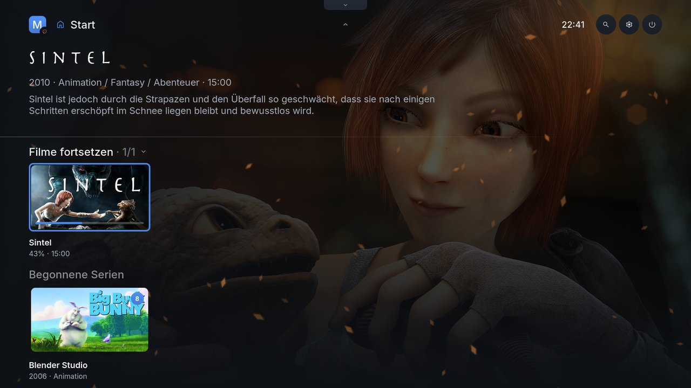

## Widget-Editor

Welche Zeilen ein Bereich zeigt, legst du im **Widget-Editor** fest – erreichbar über „Widgets bearbeiten“ in jedem
Untermenü. Der Bereich ist dann schon vorgewählt.

- **Katalog mit über 50 Zeilen** in Kategorien: zuletzt hinzugefügt, begonnen, zufällig, ungesehen, Genres, Addons,
  TV-Sender, Aufnahmen, Radio, Wetter, Smart Home, TV-Tipps, TMDb-Trends …
- **Eigene Quelle aus jedem Ordner**: Kodi öffnet Bibliothek, Playlists, Addons oder Medienquellen. Du gehst zum
  gewünschten Ordner – auch tief in einem Addon – und wählst im Optionen-Panel **„Als Startseiten-Zeile verwenden“**.
  Name und Darstellung übernimmt der Skin passend zum Inhalt.
- **Darstellung** je Zeile (Querformat, Quadrat, Kacheln, Wetter), **eigene Überschrift**, Zeilen umsortieren.

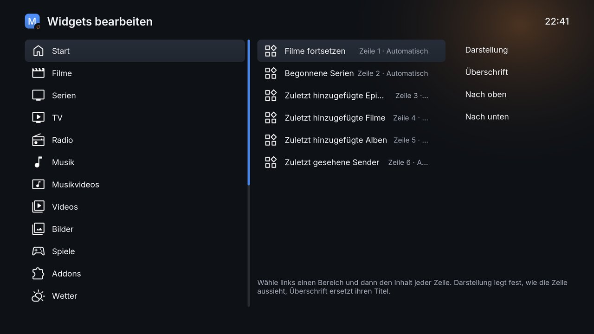

## Menü-Editor und Seitenmenü

- Im **Menü-Editor** bestimmst du Reihenfolge und Sichtbarkeit der Bereiche. Dazu kommen **sechs freie Bereiche**
  mit eigenem Namen, Symbol und Ziel (Addon, Ordner, Playlist oder Befehl). Oben passen 11 Einträge, im Seitenmenü
  alle.
- Das Hauptmenü ist **verborgen**, bis du es brauchst – so hat der Inhalt den ganzen Bildschirm. Es öffnet sich
  oben (mit Unterpunkten in einer zweiten Zeile) oder, wenn du willst, als **Leiste am linken Rand**, die auf Symbole
  zusammenklappt.
- Untermenüs bringen nur das Nötige: etwa „Videodatenbank aktualisieren“ bei Filmen, „Updates“ bei Addons nur, wenn
  es Updates gibt, und die Zahl der Updates direkt im Menü („Addons (3)“).

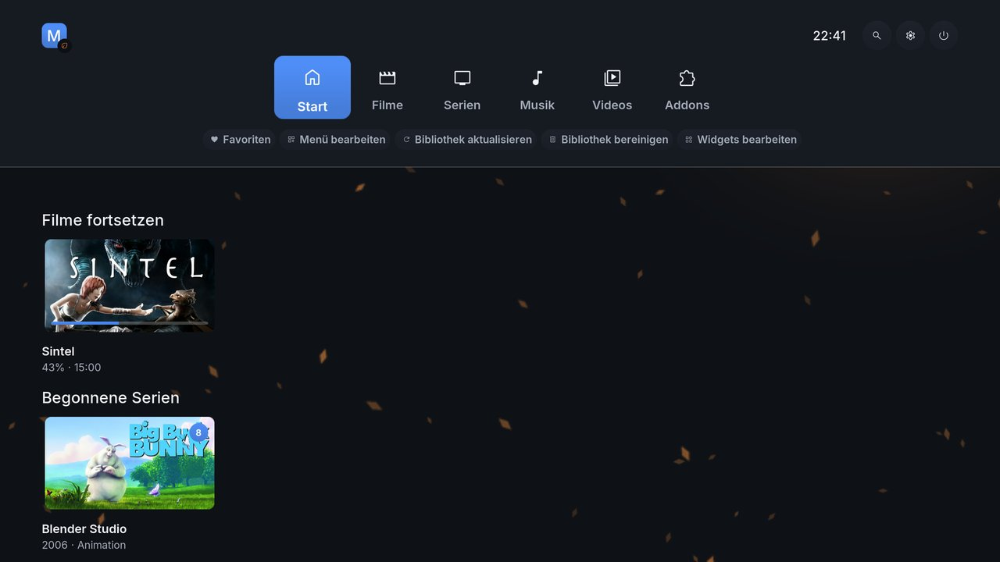

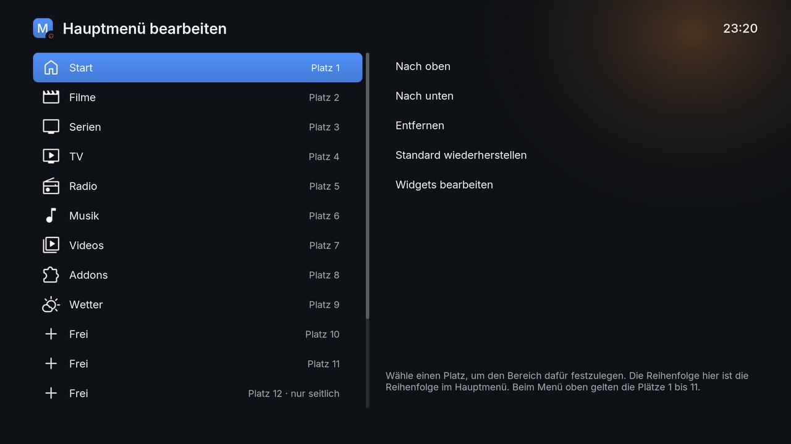

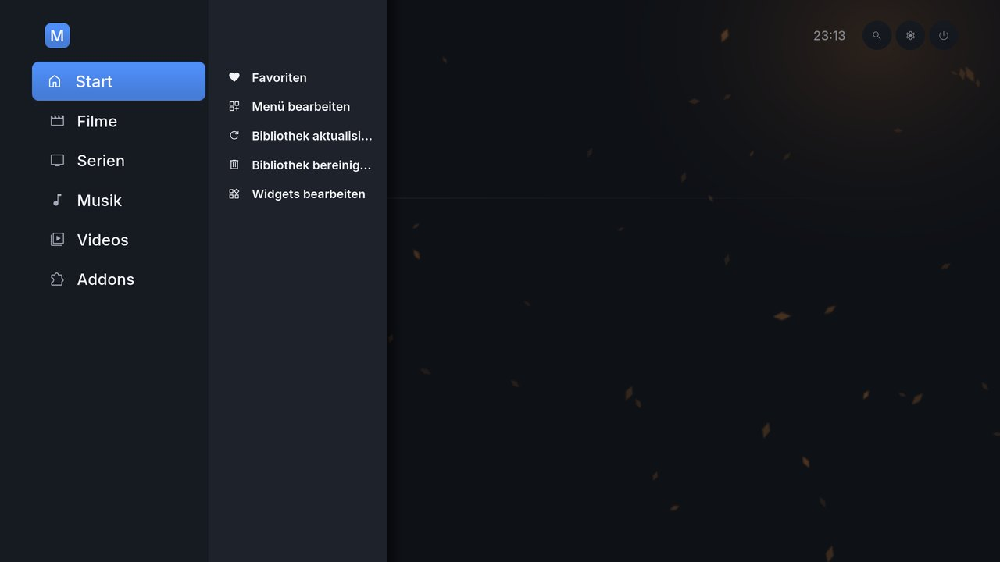

## Zentrale

Die **Zentrale** ist ein eigener Bereich mit Live-Kacheln: laufende Wiedergabe, Unwetterwarnung, Wetter, laufende und
nächste Aufnahme, Bibliothek, Addon-Updates, System (CPU und Arbeitsspeicher), Speicherplatz, Netzwerk und
Netzwerkgeräte. Jede Kachel führt mit OK direkt an die passende Stelle. Mit Skinhelper Ping lassen sich Server
anzeigen und per Wake on LAN aufwecken.

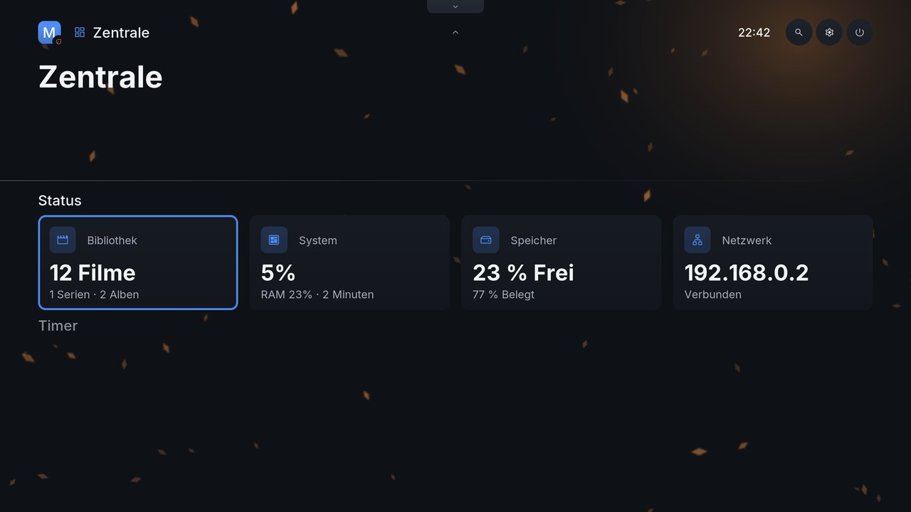

## Suche

Ein **eigenes Suchfenster** durchsucht die ganze Bibliothek auf einmal – Filme, Serien, Folgen, Musikvideos,
Interpreten, Alben und Lieder – und zeigt die Treffer nach Art getrennt in Zeilen wie auf der Startseite. Mit dem Addon
Autocompletion erscheinen schon beim Tippen Vorschläge.

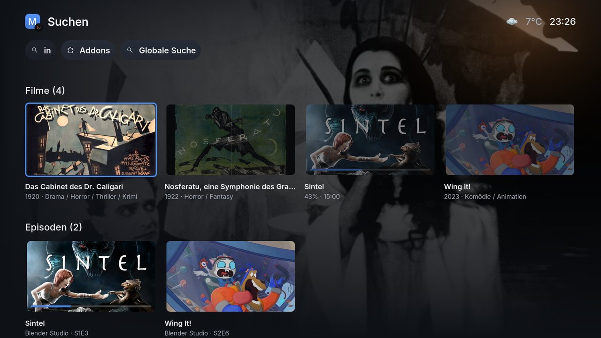

## Medienansichten

Filme, Serien und Musik gibt es in vielen Ansichten: **Liste, Detailliste, Poster, Querformat, Breit, Quadratisch,
Kacheln, Schaukasten** und **Fanart**. Jede Bibliothek merkt sich ihre Ansicht.

- **Hüllen**: Poster in Klarsichthüllen mit Klammern und Glanz, auf Wunsch mit farbigem Rücken je Auflösung
  (8K, 4K, 1080 …).
- **Optionen-Panel** am rechten Rand statt verschachtelter Menüs: Ansicht, Sortieren, Filtern, Suchen, Springen zu
  Buchstabe und Bibliothek aktualisieren an einer Stelle.
- **Springen per Zifferntaste** wie beim SMS-Tippen; beim schnellen Blättern zeigt ein großer Buchstabe, wo du bist.
- **Erzeugte Altersplaketten** (FSK, MPAA, TV) und Genre-Symbole – ohne zusätzliche Bildpakete.
- Bei Serien zeigt die Kachel, wie viele Folgen noch offen sind, und die Info bietet **„Weiter mit“** der nächsten Folge.

| | |
|---|---|
| 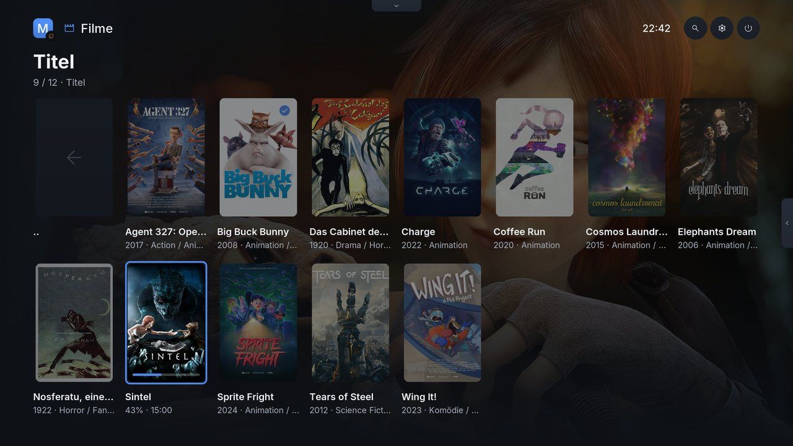 | 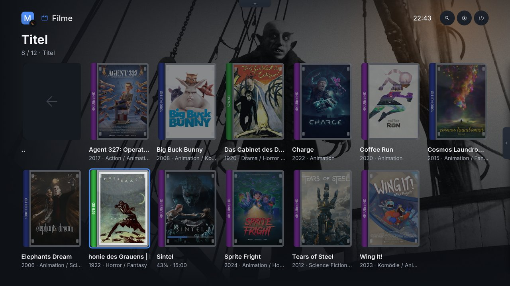 |
| 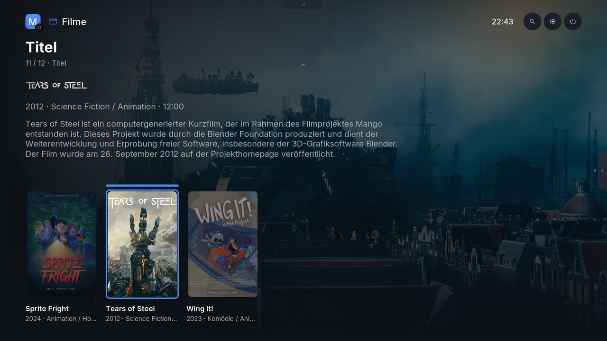 | 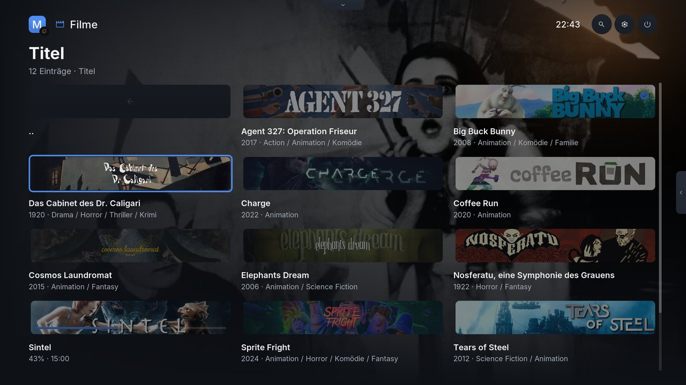 |
| 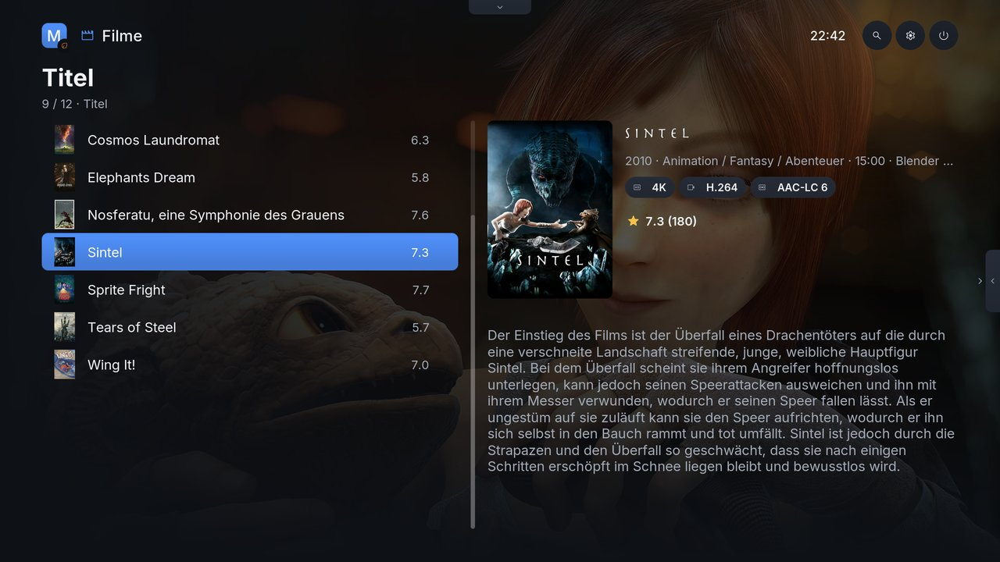 | 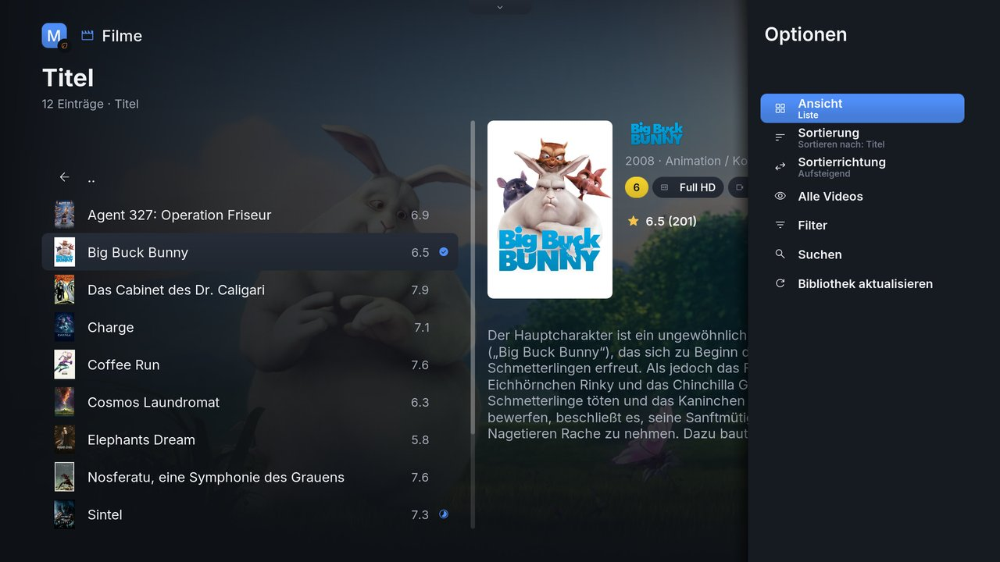 |

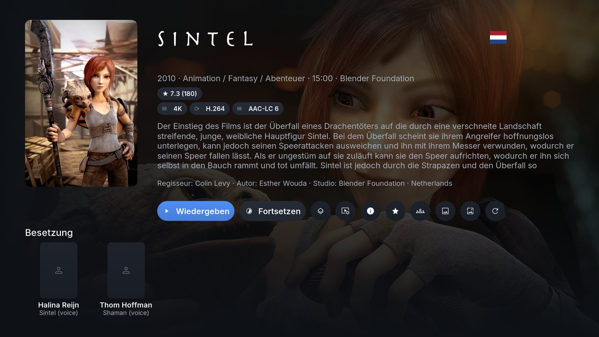

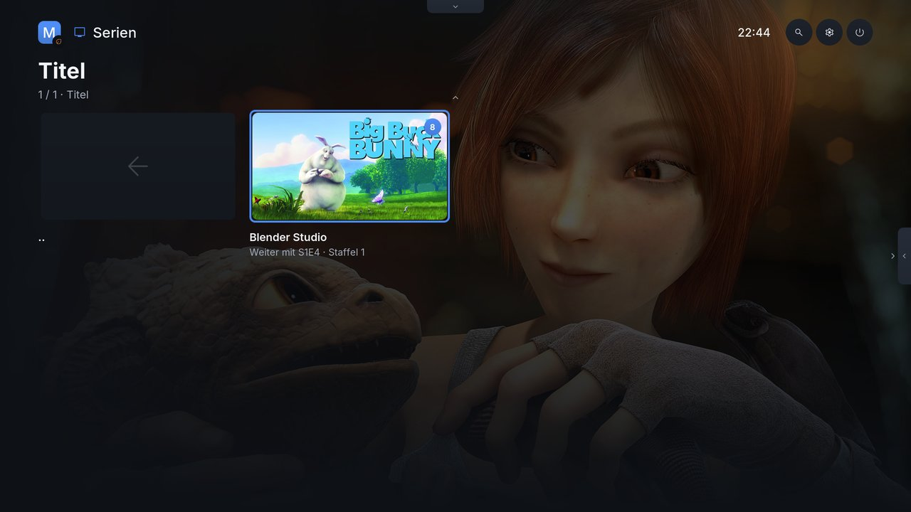

## Musik-Vollbild

- Hinter dem Cover **dreht sich eine Scheibe**: das CD-Bild des Albums oder eine Schallplatte mit dem Cover als Etikett.
- Mit Artist Slideshow: **Bilder des Künstlers** als Hintergrund und seine **Biografie**.
- Mit CU LRC Lyrics: **Liedtexte**, bei LRC-Dateien zeitgenau mitlaufend.
- Bei **Internetradio** steht das Senderlogo auf einer hellen Kachel.
- Die Taste **Info** blendet alle Einblendungen aus und wieder ein; bei einem Titelwechsel erscheint kurz eine Titelkarte.

| | |
|---|---|
| 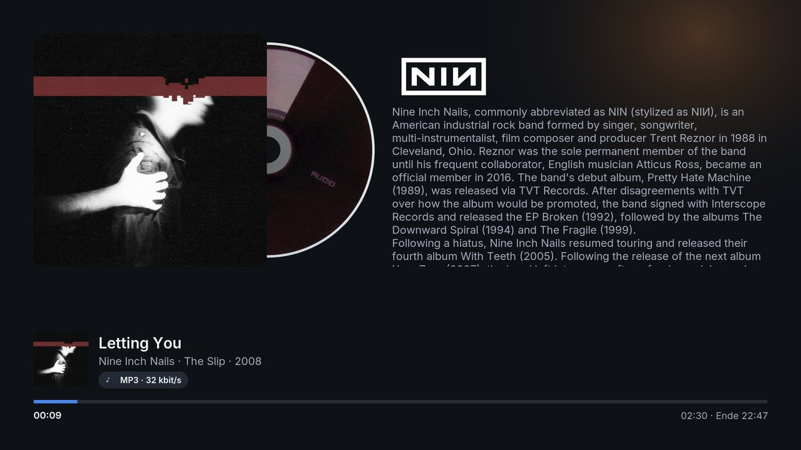 | 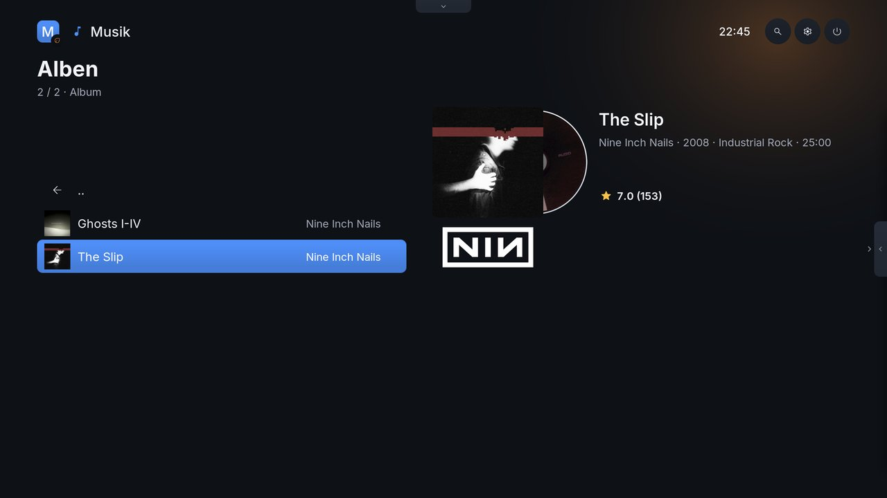 |

## Wiedergabe

- **Video-OSD** in drei Gruppen: links Spuren, Untertitel und Einstellungen, in der Mitte die Steuerung, rechts Extras.
- Die Info zeigt Auflösung, Ton und Sprache – die Sprache als Fahne.
- **Bei Pause** wahlweise nichts, eine leichte Abdunklung oder Abdunklung mit Titel und Zeit.
- **Mini-Player** in der Kopfzeile, solange etwas im Hintergrund läuft.
- **„Als Nächstes“**: kurz vor dem Ende kündigt eine kleine Karte den nächsten Titel an.

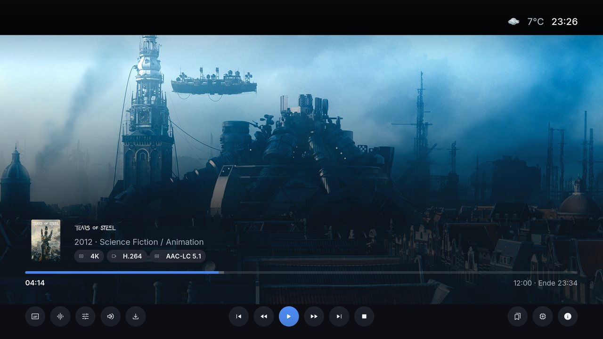

## Wetter

- Wetter als Startseiten-Zeile in drei Formen: **Vorhersage** (jetzt und sieben Tage), **stündlich** und **Details**
  (gefühlte Temperatur, Wind, Luftfeuchte, UV, Sonnenaufgang …).
- **Einheitliche Wettertexte**: kurz und vollständig übersetzt statt halb englischer Texte vieler Wetterdienste.
- Animierte Wetter-Symbole und Wetter-Hintergründe aus Bildpaketen.

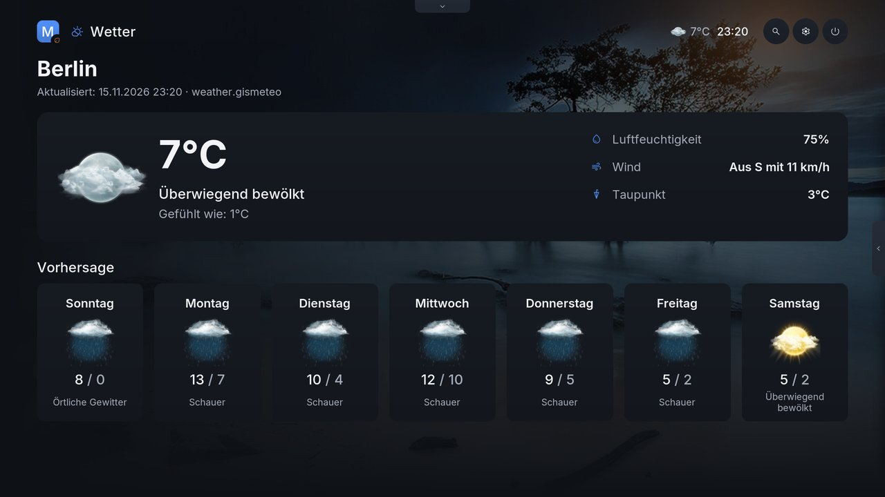

## Motive, Farben und saisonale Effekte

Neben dem Standard gibt es **Vorlagen** (Kante, Papier, Beton) und **Motive** (Motocross, Klettern, Bouldern,
Computer-Nerd), die Kachelformen, Fokusrahmen, Schrift und einen eigenen Hintergrundeffekt mitbringen. Dazu kommen vier
Farbschemata, sieben Akzentfarben plus eigene oder zufällige Farbe und **saisonale Effekte** zu Jahreszeit und
Feiertagen. Alles im Detail mit Bildern: **[Motive und Aussehen](Motive.md)**.

| | | |
|---|---|---|
| 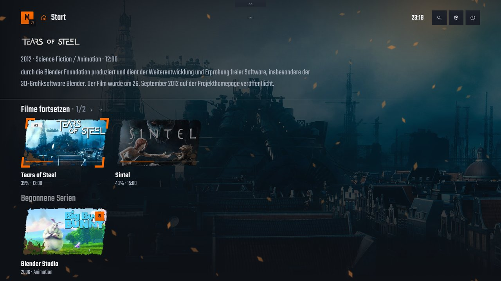 | 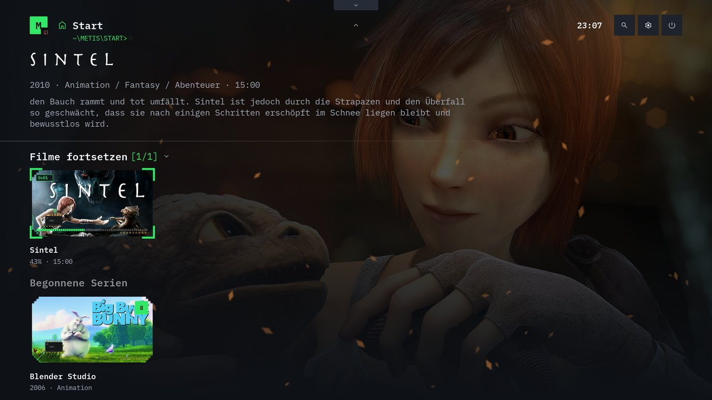 |  |

## Einstellungen mit Erklärung

- **Zu jeder Einstellung ein Hinweistext** unten im Fenster – du musst nichts ausprobieren, um zu wissen, was sie tut.
- Nach Themen geordnet: Allgemein, Design und Vorlagen, Startseite und Menüs, Medienansichten, Bildpakete,
  Wiedergabe und OSD, Energiemenü, Erweitert.
- **Bildpakete** (Wetter, Studios, Plattenlabels, Länder, Genres) an einer Stelle mit Vorschau.
- **Kiosk-Modus**: blendet alles aus, womit sich etwas verstellen ließe.
- **Beim Start**: Lautstärke festlegen und eine Playlist, Datei oder einen Sender automatisch abspielen.
- **Feedback** mit QR-Code direkt aus Kodi.

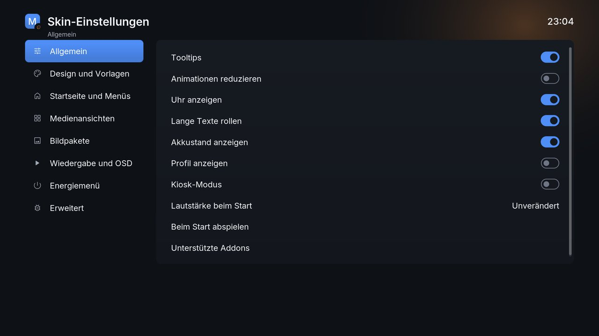

## Für jedes Gerät

- **Jedes Bildformat**: eigene Layouts für 16:9, 21:9, 4:3, 16:10 und weitere – nichts wird verzerrt oder abgeschnitten.
- **TV-Sicherheitsrand**: rückt alles 5 % vom Rand weg, wenn der Fernseher den Bildrand abschneidet.
- **Touch und Maus**: Laschen an den Rändern öffnen Menü und Optionen, Wischen blättert.
- **Animationen reduzieren** für langsame Geräte – schaltet auch alle Hintergrundeffekte ab.
- **Schriftgrößen**: Standard, Groß und Noto (für viele Schriftsysteme).

---

[← Zur Übersicht](README.md)
