# Motive und Aussehen

Das Aussehen von Metis setzt sich aus vier Teilen zusammen, die du frei kombinierst:

1. **Theme** – die Form der Oberfläche: Standard, eine der Vorlagen *Kante*, *Papier*, *Beton* oder ein **Motiv**
2. **Farbschema** – Dunkel, Hell, OLED oder Kontrast
3. **Akzentfarbe** – die Farbe von Fokus, Hervorhebungen und Fortschritt
4. **Effekte** – saisonale Akzente, Hintergrundeffekte und Lichtstreif

Theme, Farbschema und Schrift wählst du unter **Skin-Einstellungen → Design und Vorlagen → Farbschema, Vorlage und
Schrift** (das öffnet Kodis Oberflächeneinstellungen). Alles andere steht direkt in **Design und Vorlagen**.

- [Standard und Vorlagen](#standard-und-vorlagen)
- [Motive](#motive)
- [Farbschemata](#farbschemata)
- [Akzentfarben](#akzentfarben)
- [Saisonale Akzente und Hintergrundeffekte](#saisonale-akzente-und-hintergrundeffekte)

---

## Standard und Vorlagen

Die Vorlagen ändern nur die Form – Ecken und Flächen. Farben, Schrift und Inhalte bleiben gleich.

| Theme | Form |
|---|---|
| **Standard** | abgerundete Ecken, Flächen mit sanftem Verlauf |
| **Kante** | eckig, mit Verlauf |
| **Papier** | abgerundet, flache Flächen ohne Verlauf |
| **Beton** | eckig und flach |

| | |
|---|---|
| 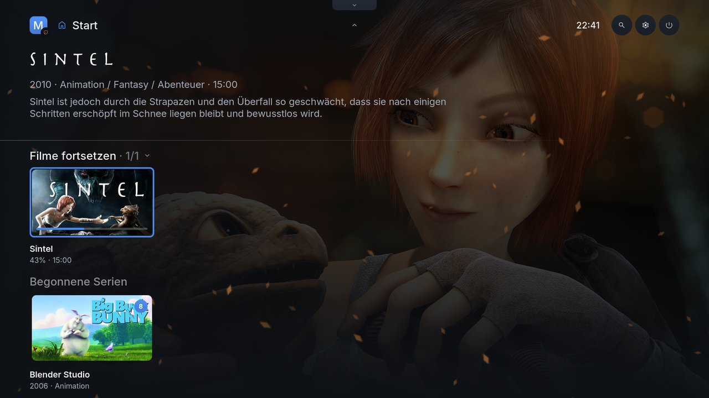 **Standard** | 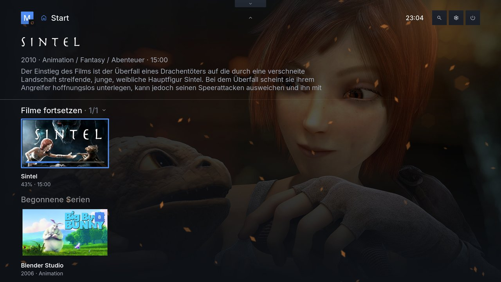 **Kante** |
|  **Papier** |  **Beton** |

## Motive

Ein Motiv geht weiter als eine Vorlage. Es bringt mit:

- **eigene Kachelformen** – schräg, ausgefranst, mit abgeschlagenen Ecken oder Pixel-Treppen
- **Spuren auf den Covern** – Schlamm, Kreide, Griffe oder Leiterbahnen, abwechselnd je Listenplatz
- **eigenen Fokusrahmen** und einen **Akzent** am markierten Eintrag
- **eigene Fortschrittsbalken**
- **eigene Schrift** für die ganze Oberfläche – sie wird beim Wechsel des Motivs automatisch gewählt
- **eigene Akzentfarbe** (gilt, solange die Akzentfarbe auf *Standard* steht)
- **eigenen Hintergrundeffekt**, abschaltbar mit **Motiv-Effekt**

### Motocross

Schräge Kacheln mit ausgefranstem Rand, Schlammspritzer und Kratzer auf den Covern, Zielklammern als Fokusrahmen und
eine Startnummer **#1** am markierten Eintrag. Schrift *Teko*, Farbe Orange. Im Hintergrund weht **Staub** von rechts
nach links.

| | |
|---|---|
| 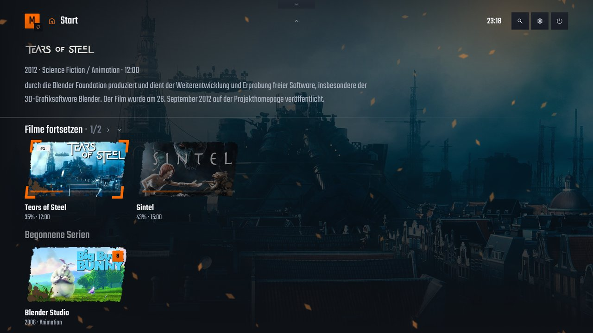 | 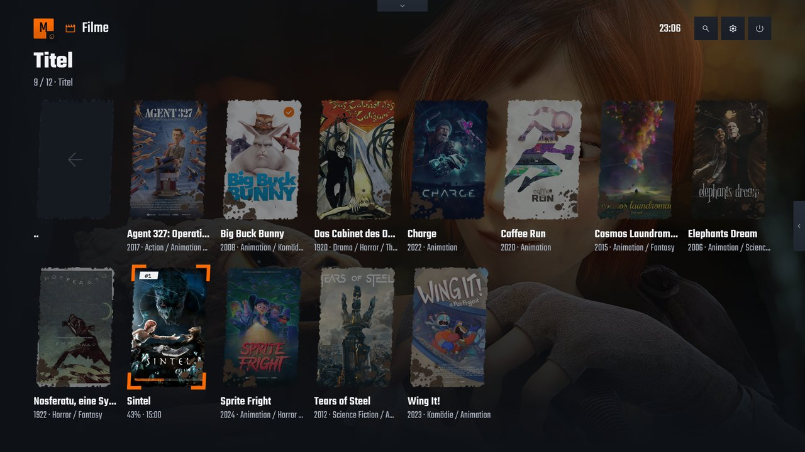 |

### Klettern

Kacheln wie Fels mit abgeschlagenen Ecken, Risse, Kanten und Klettergriffe mit Kreidespuren auf den Covern,
Fortschritt als geflochtenes Seil. Schrift *Bitter*, Farbe Sand. Im Hintergrund schwebt **Kreidestaub** langsam nach oben.

| | |
|---|---|
| 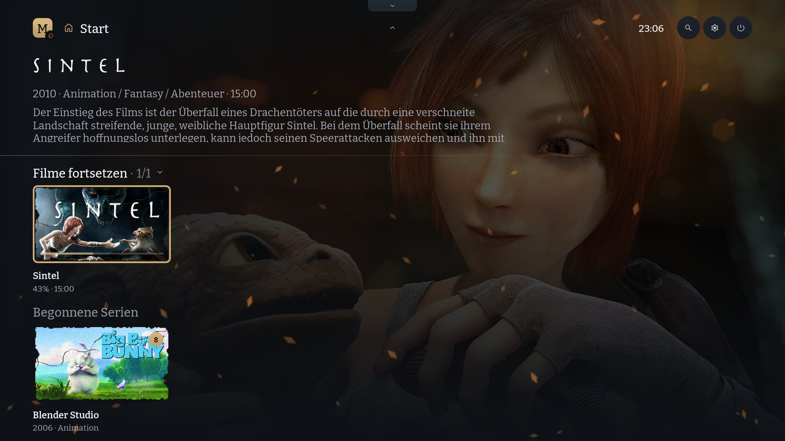 | 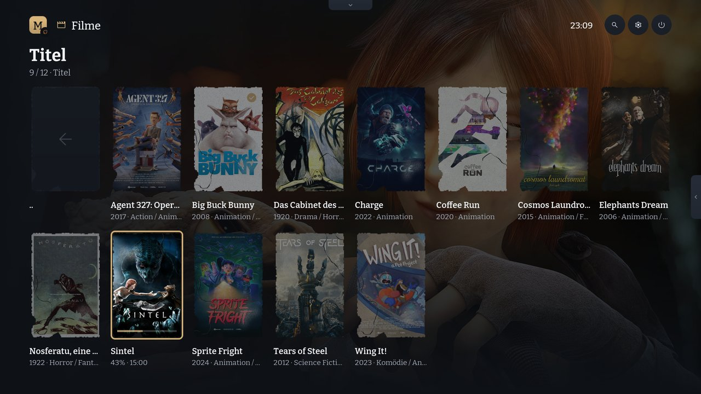 |

### Bouldern

Abgerundete, leicht ausgefranste Kacheln, Kreide-Handabdrücke und bunte Griffe aus Kunstharz, ein gelbes Routen-Tape
**TOP** am markierten Eintrag, Fortschritt in Griff-Abschnitten. Handschrift *Patrick Hand*, Farbe Gelb. Im
Hintergrund schwebt **Kreidestaub**.

### Computer-Nerd

Kacheln mit Pixel-Treppen an den Ecken, grüne Leiterbahnen auf den Covern, Speicheradresse **0x01** am markierten
Eintrag, Fortschritt in Blöcken. Ganze Oberfläche in der Terminal-Schrift *IBM Plex Mono*, Positionen als „[3/21]“,
Farbe Grün. Im Hintergrund fallen **Bits** (0 und 1) wie im Terminal.

| | |
|---|---|
| 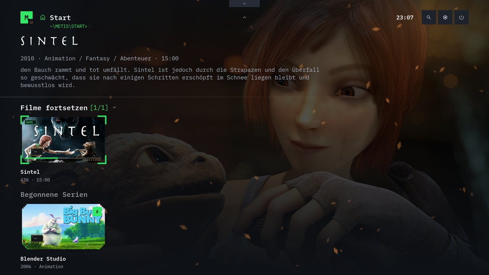 | 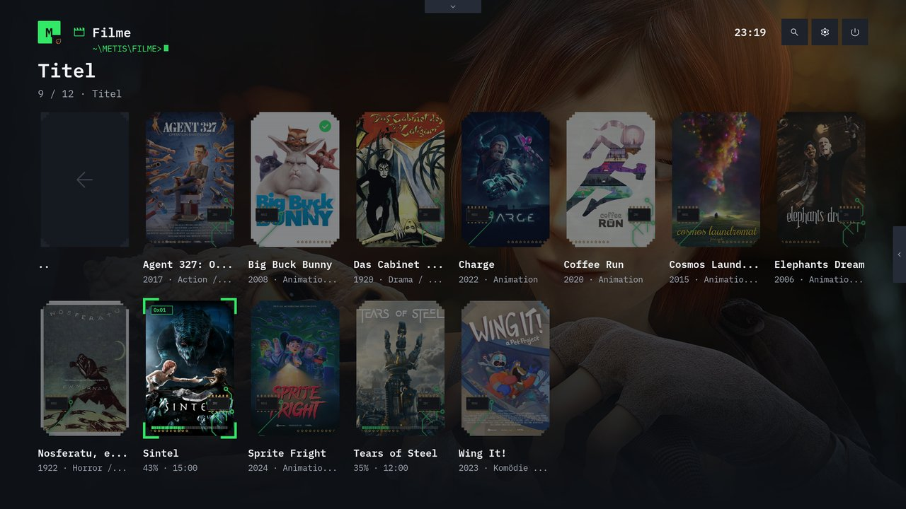 |

## Farbschemata

Das Farbschema bestimmt Hintergrund, Flächen und Text. Es lässt sich mit jedem Theme kombinieren.

| Farbschema | Wofür |
|---|---|
| **Dunkel** (Standard) | dunkelblaugrau, angenehm am Abend |
| **Hell** | heller Hintergrund, dunkle Schrift |
| **OLED** | reines Schwarz – schont OLED-Fernseher und spart Strom |
| **Kontrast** | schwarzer Hintergrund mit hellen, kräftigen Linien für bessere Lesbarkeit |

| | | |
|---|---|---|
| 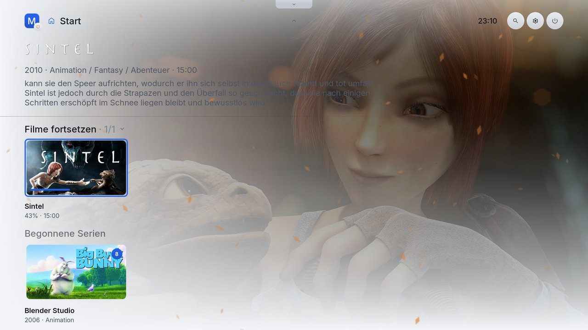 **Hell** | 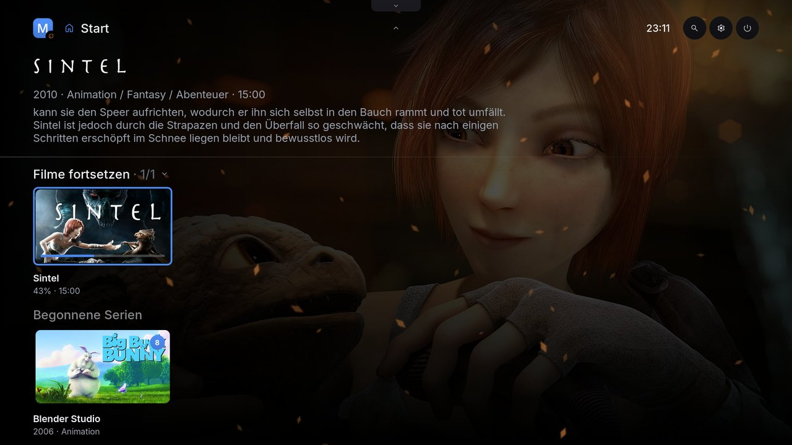 **OLED** | 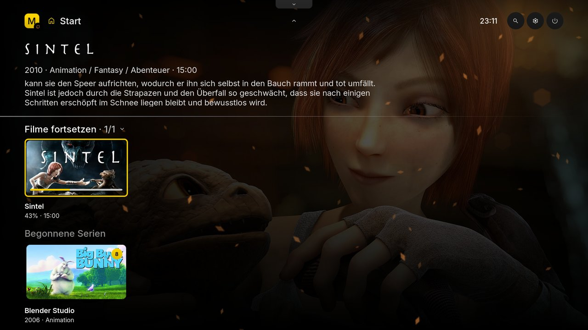 **Kontrast** |

## Akzentfarben

Die Akzentfarbe färbt Fokusrahmen, Hervorhebungen und Fortschrittsbalken.

- **Standard** nimmt die Farbe aus dem Farbschema oder, bei einem Motiv, die Farbe des Motivs.
- Sieben feste Farben: **Blau, Violett, Grün, Orange, Rot, Pink, Türkis**.
- **Eigene Akzentfarbe** frei wählbar.
- **Zufällige Akzentfarbe bei jedem Start** – bleibt bis zum nächsten Start (nicht bei Motiven).

Weitere Schalter unter *Design und Vorlagen*: **Artwork als Hintergrund**, **Fanart-Diashow**, **Hintergrund
abdunkeln** (fünf Stufen), **Kacheln leicht durchsichtig** und der **Lichtstreif**, der ab und zu an der Trennlinie über
den Inhaltszeilen entlanggleitet.

## Saisonale Akzente und Hintergrundeffekte

Im Hintergrund der Startseite können drei Effekte laufen – **jeder mit eigenem Schalter, alle drei auch gleichzeitig**:

| Schalter | Effekt | Wann |
|---|---|---|
| **Saisonale Akzente** | Feiertagsteilchen: Schnee zu Weihnachten, Konfetti zu Silvester, Blüten zu Ostern – dazu ein dezentes Leuchten oben rechts und ein kleines Symbol am Logo | an Feiertagen; Leuchten und Symbol das ganze Jahr passend zu Jahreszeit und Feiertag |
| **Saisonale Effekte** | Jahreszeitteilchen: Laub im Herbst, Schnee im Winter | im Herbst und Winter |
| **Motiv-Effekt** | Staub, Kreidestaub oder Bits | bei einem Motiv |

Im Advent fallen so etwa Laub und Schnee zusammen, bei einem Motiv kommt dessen Effekt dazu. Die Teilchen laufen in zwei
Ebenen (fern und klein, nah und schneller) und werden weich ein- und ausgeblendet. **Animationen reduzieren** schaltet
alle Teilchen ab.

---

[← Zur Übersicht](README.md)
