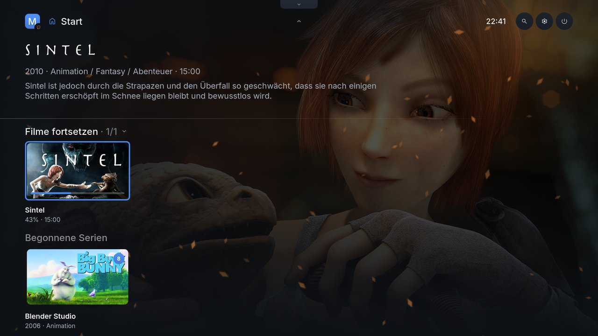
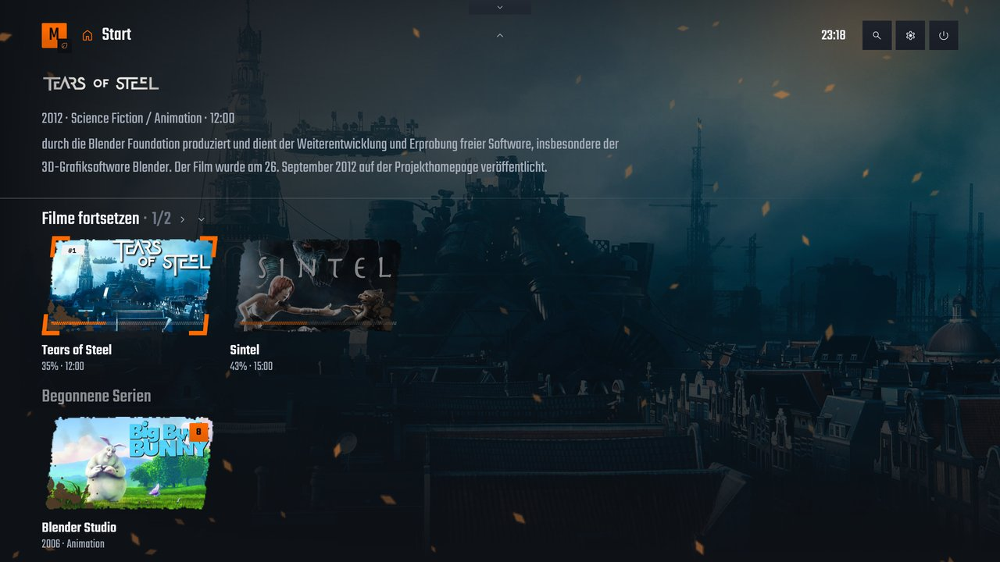
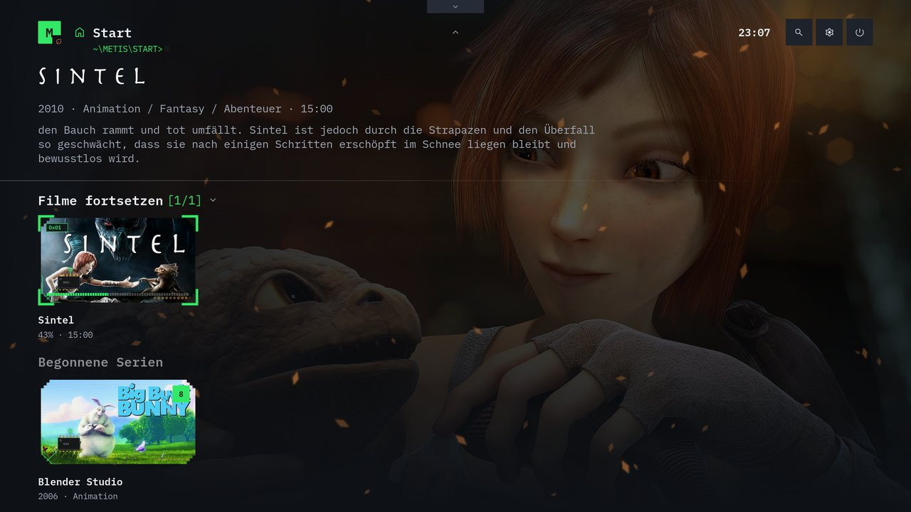
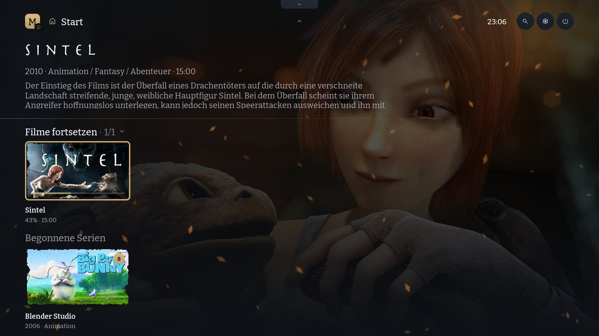
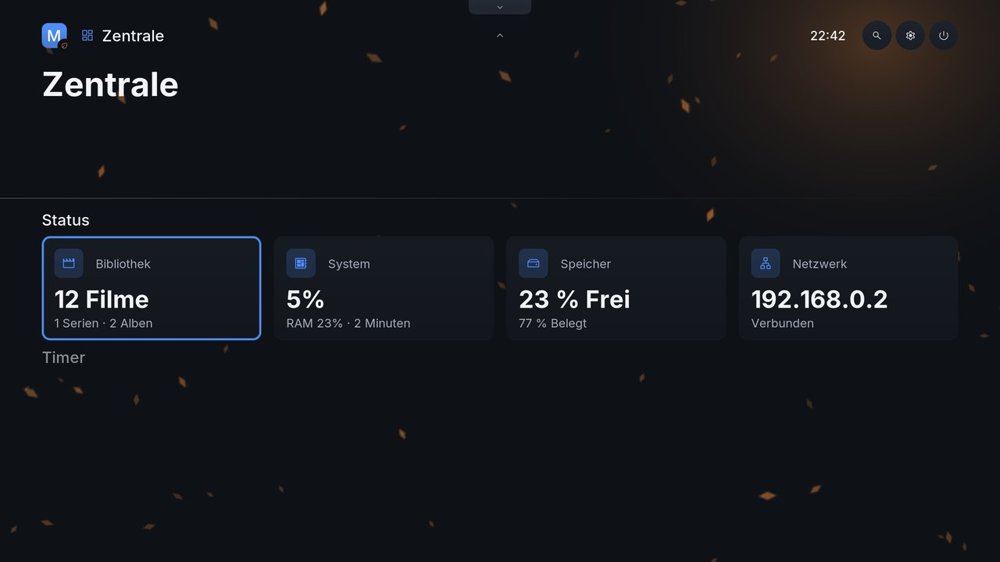
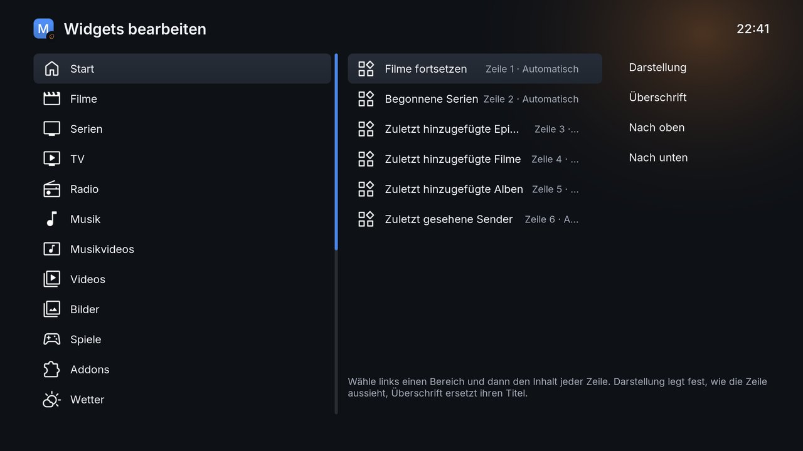
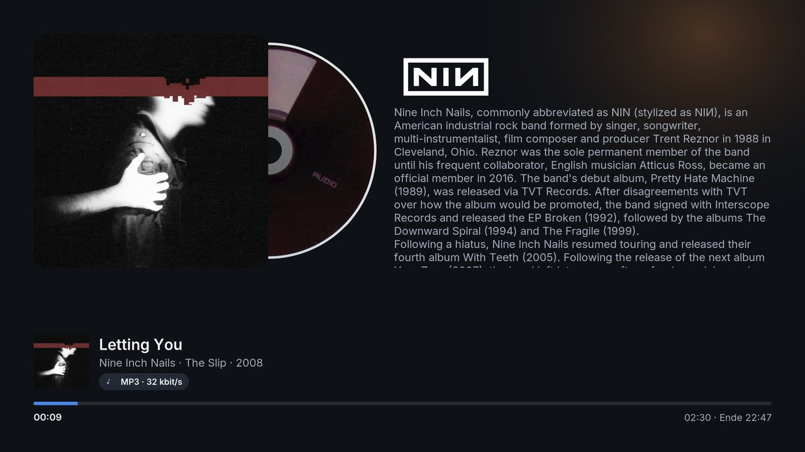
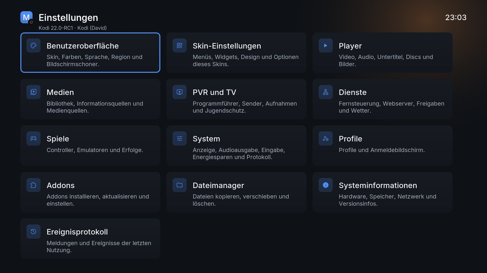
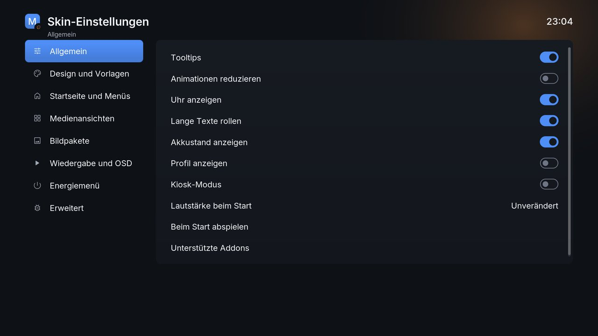

# Metis – Skin für Kodi 22

Metis ist ein Skin für **Kodi 22 „Piers“**. Er ist ruhig und aufgeräumt, zeigt viel Bild und
wenig Rahmen und lässt sich mit Fernbedienung, Tastatur, Maus und Touch gleich gut bedienen. Er passt sich jedem
Bildformat an (16:9, 21:9, 4:3, 16:10 …) und funktioniert bis 4K.

## Die Idee hinter Metis

Metis soll ruhig und aufgeräumt sein und sich einfach bedienen lassen. Im Mittelpunkt stehen deine Filme, Serien und
deine Musik, nicht der Skin selbst.

- **Viel Bild, wenig Rahmen:** Cover und Hintergrundbilder bekommen den meisten Platz. Das Hauptmenü bleibt verborgen,
  bis du es brauchst.
- **Du weißt immer, wo du bist:** Der markierte Eintrag ist überall gleich deutlich hervorgehoben. Positionsangaben und
  kleine Pfeile zeigen, wohin es weitergeht.
- **Bedienung, wie du sie magst:** Fernbedienung, Tastatur, Maus und Touch funktionieren gleich gut. Jedes Element
  erreichst du mit den Pfeiltasten, nichts ist eine Sackgasse.
- **Deine Startseite:** Jeder Bereich zeigt die Zeilen, die du willst, bis zu sechs. Du kannst auch Inhalte aus jedem
  beliebigen Ordner oder Addon übernehmen. Menü und Bereiche ordnest du selbst.
- **Dein Aussehen:** Du wählst Form, Motiv, Farbschema, Akzentfarbe und Schriftgröße. Effekte sind Zusatz, und jeden
  kannst du einzeln abschalten.
- **Passt auf jeden Bildschirm:** Metis läuft in jedem Bildformat bis 4K, nichts wird verzerrt. Schneidet dein
  Fernseher den Rand ab, rückt ein Sicherheitsrand alles nach innen.
- **Läuft auch auf schwachen Geräten:** „Animationen reduzieren“ schaltet Bewegungen und Effekte ab.
- **Nichts muss, alles kann:** Zusatz-Addons sind freiwillig. Fehlt eines, blendet Metis die passenden Knöpfe einfach
  aus, statt Fehler zu zeigen.
- **Erklärt sich selbst:** Zu jeder Einstellung zeigt Metis einen kurzen Hinweistext. Du musst nichts ausprobieren, um
  zu wissen, was sie bewirkt.

## Auf einen Blick

| | |
|---|---|
| **[Was Metis anders macht](Besonderheiten.md)** | Die Funktionen, die über einen üblichen Kodi-Skin hinausgehen – mit Bildern |
| **[Motive und Aussehen](Motive.md)** | Vorlagen, Motiv-Themes, Farbschemata, Akzentfarben und saisonale Effekte |
| [Bedienung](Bedienung.md) | Hauptmenü, Startseite, Medienansichten, Wiedergabe, Touch und Maus |
| [Bereiche und Startseite](Bereiche.md) | Alle Bereiche, ihre Unterpunkte und Inhaltszeilen *(erzeugt)* |
| [Einstellungen](Einstellungen.md) | Alle Skin-Einstellungen mit Erklärung und Standardwert *(erzeugt)* |

<table>
<tr>
<td></td>
<td></td>
<td></td>
</tr>
<tr>
<td></td>
<td></td>
<td></td>
</tr>
</table>

## Installation und erster Start

1. Das ZIP herunterladen und in Kodi über **Einstellungen → Addons → Aus ZIP-Datei installieren** einspielen.
2. Den Skin unter **Einstellungen → Benutzeroberfläche → Skin** wählen.
3. Beim ersten Start fragt der Einrichtungsassistent nach Lage des Hauptmenüs (oben oder seitlich),
   Akzentfarbe und Tooltips. Alles lässt sich später in den Skin-Einstellungen ändern.
4. Ist die Bibliothek noch leer, zeigt die Startseite eine Begrüßung mit den nächsten Schritten:
   Videoquelle hinzufügen, Musikquelle hinzufügen, Addons entdecken.

Alle Einstellungen des Skins findest du unter **Einstellungen → Skin-Einstellungen**, nach Themen geordnet. Zu jeder
Einstellung steht unten im Fenster ein Hinweistext (alle Texte: [Einstellungen](Einstellungen.md)).

## Unterstützte Addons

Alle Addons sind **freiwillig**. Ist ein Addon nicht installiert oder deaktiviert, blendet der Skin die zugehörigen
Knöpfe und Zeilen aus. Die Liste mit Status und Installationsknopf findest du unter
**Skin-Einstellungen → Allgemein → Unterstützte Addons**.

| Addon | Wofür |
|---|---|
| TV-Tipps (script.service.gto) | Tipps im Bereich TV, eigenes Infofenster mit Umschalten, Aufnehmen und Erinnern |
| Globale Suche (script.globalsearch) | durchsucht die ganze Bibliothek auf einmal |
| CU LRC Lyrics (script.cu.lrclyrics) | Liedtexte im Musik-Vollbild, zeitgesteuert bei LRC |
| Artist Slideshow (script.artistslideshow) | Interpreten-Bilder und Biografie im Musik-Vollbild |
| TMDb Helper | zusätzliche Inhaltszeilen (Trends, Beliebt, Demnächst im Kino) und Infos |
| Library Data Provider | Zeile „Nächste Folgen“ |
| Fritz Smart Home (script.program.fritzact) | FRITZ!DECT-Geräte als Zeile mit Schaltern |
| Skinhelper Ping | Server-Status und Aufwecken (Wake on LAN) in Zentrale und Energiemenü |
| Autocompletion | Vorschläge über der Bildschirmtastatur |
| Image Resource Select | Bildpakete (Wetter, Studios, Genres …) bequem auswählen |

## Fragen und Hilfe

Rückmeldungen und Wünsche: in Kodi unter **Skin-Einstellungen → Erweitert → Feedback senden** (QR-Code zum Scannen)
oder direkt auf [GitHub](https://github.com/blauesgruen/skin.metis-wiki/issues/new). Im Feedback-Fenster stehen auch
die Angaben, die für eine Fehlermeldung hilfreich sind.
